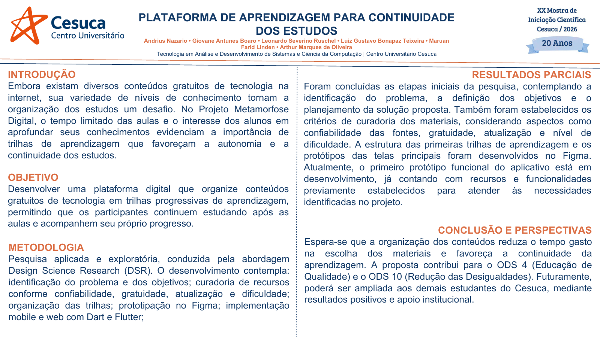

# JornadaTech · Plataforma de aprendizagem para continuidade dos estudos

> 🏆 **1º lugar na XX Mostra de Iniciação Científica do Cesuca (2026)**

O JornadaTech é um app em Flutter (mobile e web) que organiza **conteúdos gratuitos de tecnologia** em **trilhas progressivas de aprendizagem**. Ele faz a ponte entre a ementa das aulas do Cesuca / Projeto Metamorfose Digital e o conteúdo aberto que a aprofunda. Assim, os participantes continuam estudando depois das aulas e acompanham o próprio progresso.

Contribui para o **ODS 4** (Educação de Qualidade) e o **ODS 10** (Redução das Desigualdades).



---

## Sumário

- [O problema](#o-problema)
- [Objetivo](#objetivo)
- [Metodologia](#metodologia)
- [Funcionalidades](#funcionalidades)
- [Tecnologias](#tecnologias)
- [Como rodar](#como-rodar)
- [Estrutura do projeto](#estrutura-do-projeto)
- [Equipe](#equipe)
- [Como contribuir](#como-contribuir)
- [Próximos passos](#próximos-passos)
- [Documentos](#documentos)

## O problema

Existe muito conteúdo gratuito de tecnologia na internet, mas com níveis de conhecimento tão variados que organizar os estudos vira um desafio. No Projeto Metamorfose Digital, o tempo limitado das aulas e o interesse dos alunos em se aprofundar mostram a importância de trilhas de aprendizagem que favoreçam a autonomia e a continuidade dos estudos.

## Objetivo

Desenvolver uma plataforma digital que organize conteúdos gratuitos de tecnologia em trilhas progressivas, permitindo que os participantes continuem estudando após as aulas e acompanhem seu próprio progresso.

## Metodologia

Pesquisa aplicada e exploratória, conduzida pela abordagem **Design Science Research (DSR)**:

1. Identificação do problema e dos objetivos
2. Curadoria de recursos conforme **confiabilidade, gratuidade, atualização e dificuldade**
3. Organização das trilhas
4. Prototipação no Figma
5. Implementação mobile e web com Dart e Flutter ← *estamos aqui*

## Funcionalidades

| Tela | O que tem | Status |
|---|---|---|
| Splash | Logo animado, degradê da marca e respeito a "reduzir movimento" | ✅ |
| 01 · Login | Nome completo + senha (RF001); primeiro acesso por CPF com troca de senha obrigatória (RF002/RF003) | ✅ (mock) |
| 02 · Home | Trilhas recomendadas com progresso, busca, filtros (grátis, certificado, vídeo, offline) e favoritos | ✅ (mock) |
| Menu | Perfil, Ajuda e Sair | 🟡 Perfil ainda não existe |
| Ajuda | Como a trilha é montada e tutorial de uso | 🟡 vídeo pendente |
| 03 · Material | Aula atual, "Cobre da ementa", progresso (Não visto / Visto / Concluído), salvar offline, conteúdos relacionados e feedback | ✅ (mock) |

> **Mock:** por enquanto, usuários, trilhas e progresso ficam em memória (`lib/data/`). Ao fechar o app, tudo volta ao estado inicial.

### Usuários de teste

| Nome completo | CPF | Senha inicial |
|---|---|---|
| Ana Beatriz Ribeiro da Silva | 529.982.247-25 | `Mudar@123` |
| Carlos Eduardo Santos | 111.444.777-35 | `Mudar@123` |

No primeiro login com a senha padrão, ou pelo card "Primeiro acesso" com o CPF, o app pede uma senha nova: 8 ou mais caracteres, com letras e números, diferente da padrão.

## Tecnologias

- [Flutter](https://flutter.dev) / Dart 3 (Android, iOS e web)
- `flutter_native_splash` para a tela do sistema antes do Flutter abrir
- Fontes Sora e Manrope (licença OFL, em `assets/fonts/`)
- Design no Figma (arquivo do grupo)

## Como rodar

Pré-requisito: [Flutter instalado](https://docs.flutter.dev/get-started/install) (`flutter doctor` sem erros).

```bash
git clone <URL-DO-REPOSITORIO>
cd jornadatech

# gera as pastas das plataformas (não sobrescreve lib/, test/ nem pubspec.yaml)
flutter create . --org br.edu.cesuca --platforms android,ios,web

flutter pub get
dart run flutter_native_splash:create
flutter analyze
flutter test
flutter run            # ou: flutter run -d chrome
```

## Estrutura do projeto

```
lib/
├── main.dart                     # splash → login → área logada
├── splash/                       # splash animado e logo desenhado em código
├── login/jornada_login_screen.dart   # tela 01: login, primeiro acesso, nova senha
├── home/
│   ├── home_shell.dart           # abas Trilhas/Ajuda + menu lateral
│   ├── trilhas_page.dart         # tela 02: trilhas, busca, filtros, favoritos
│   └── ajuda_page.dart           # aba Ajuda
├── material/material_screen.dart # tela 03: material da trilha
├── data/                         # mocks (auth, trilhas) e validação de CPF
└── ui/                           # cores, textos e componentes do Figma
test/                             # testes de widget (splash, login, home)
docs/                             # banner e protótipo
```

## Equipe

Tecnologia em Análise e Desenvolvimento de Sistemas e Ciência da Computação · Centro Universitário Cesuca

> Cada integrante preenche a própria linha com o que desenvolveu (pode abrir um PR só para isso).

| Integrante | GitHub | O que desenvolveu |
|---|---|---|
| Andrius Nazario | `@___` | _a preencher_ |
| Giovane Antunes Boaro | `@___` | _a preencher_ |
| Leonardo Severino Ruschel | `@___` | _a preencher_ |
| Luiz Gustavo Bonapaz Teixeira | `@gostislavtx` | Início do desenvolvimento do app em Flutter a partir do protótipo do Figma; criação e organização do repositório e do README; _a completar_ |
| Maruan Farid Linden | `@___` | _a preencher_ |

### Orientação

| Função | Nome |
|---|---|
| Professor orientador (disciplina de Projeto e Desenvolvimento Móveis) | Prof. Arthur Marques de Oliveira |
| Coordenador do curso | Prof. Evaldo Reis |

## Como contribuir

1. Puxe a `main` atualizada: `git pull origin main`
2. Crie uma branch para a sua tarefa: `git checkout -b feat/nome-da-tarefa`
   (`feat/` para funcionalidade, `fix/` para correção, `docs/` para documentação)
3. Antes de enviar, rode `flutter analyze` e `flutter test`
4. Faça commits pequenos e com mensagem clara: `git commit -m "feat: tela de perfil"`
5. Envie a branch (`git push -u origin feat/nome-da-tarefa`) e abra um **Pull Request** para a `main`
6. Pelo menos uma pessoa do grupo revisa antes do merge

## Próximos passos

- [ ] Rodar `flutter analyze` e `flutter test` na máquina de todos e corrigir o que aparecer
- [ ] Back-end / banco de dados para usuários, trilhas e progresso (ex.: Firebase ou Supabase)
- [ ] Cadastro das trilhas reais a partir da curadoria (confiabilidade, gratuidade, atualização, dificuldade)
- [ ] Tela de Perfil
- [ ] Download real para estudo offline
- [ ] Vídeo do tutorial na aba Ajuda
- [ ] Envio de feedback de link quebrado
- [ ] Publicar a versão web para demonstração

## Documentos

- [Banner da XX Mostra de Iniciação Científica (PDF)](docs/Banner_JornadaTech.pdf)
- [Protótipo das telas (PDF)](docs/prototipo-figma.pdf)
